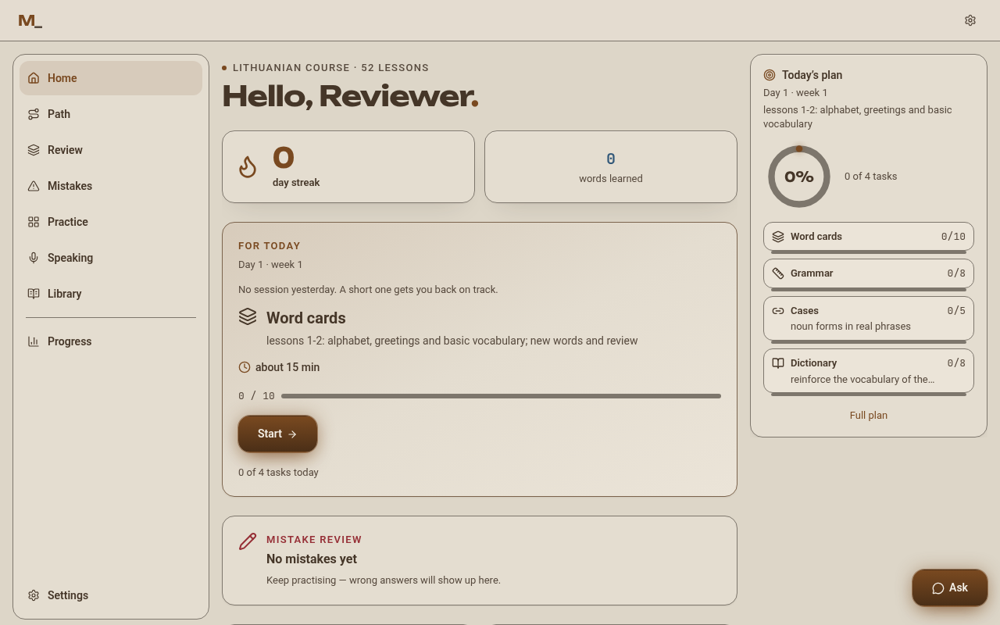
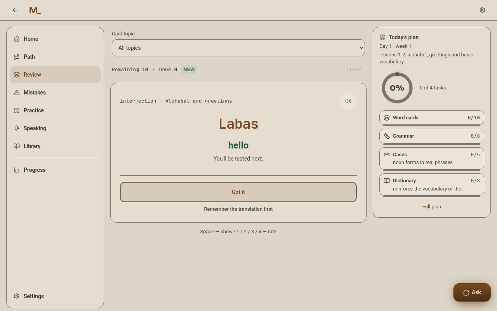
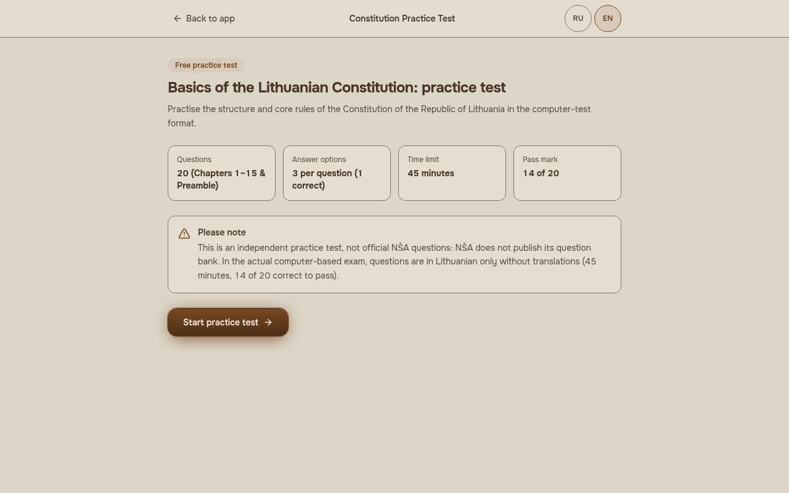
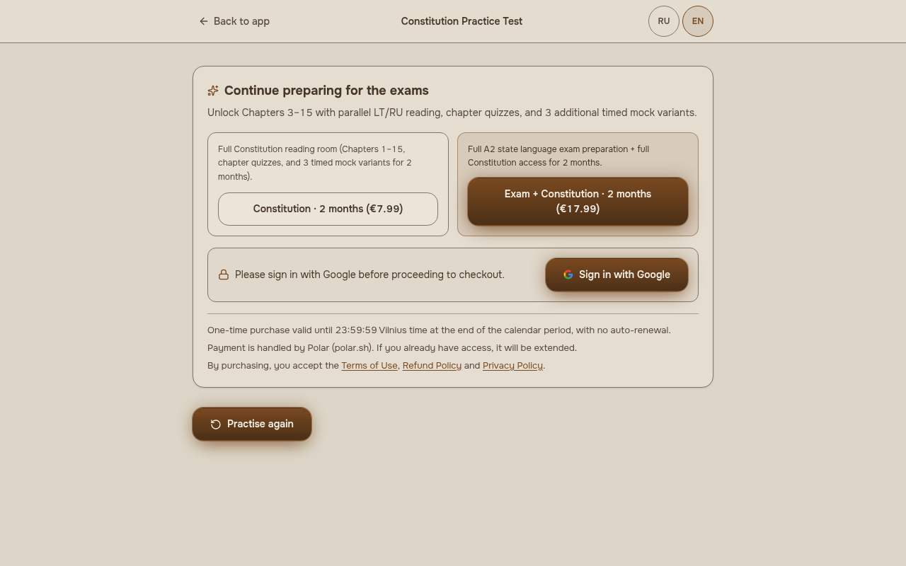

# Month — language trainer (showcase)

Live app: [month-lang-trainer.vercel.app](https://month-lang-trainer.vercel.app/)

The full project is private. This repository contains selected files that show how billing, access control, security and testing work.

## What the app is

A web app for learning Lithuanian and English. It has spaced-repetition flashcards, grammar practice, a guided Lithuanian path, speaking exercises and an AI conversation partner. You can use it as a guest, or sign in with Google and sync progress to Firebase. Some exam-preparation material is optional and is paid for through Polar as a one-time purchase, not a subscription.

## Screenshots

## What's in this repo

The files live under `code/`, with the same paths as in the private project. [`FILES.md`](FILES.md) has a one-line note on each file. This checkout is not a complete app: several tests import modules that are not included here.

**Billing, access and security**

- `code/api/_billing.js` — Polar checkout and webhook helpers: one-time purchases, two independent entitlements, idempotent grant replay, refunds, and paid-until dates in the Vilnius time zone. Product IDs and secrets come from server environment variables.
- `code/api/_billing.test.ts` — Tests for those helpers, including webhook HMAC verification and checkout plan resolution.
- `code/api/_security.js` — Firebase ID-token checks for AI and billing endpoints, App Check, a pre-auth IP limiter, and separate guest and signed-in quotas. The Firebase web API key in this copy is a placeholder.
- `code/firestore.rules` — A signed-in user may read or write only their own `users/{uid}` document (with type checks and a ban on storing `geminiKey`). `examAccess` and `billingOrders` are read and written only by the server. The client learns access status from the exam API, not from Firestore.
- `code/src/data/lt/constitution/constitutionAccess.ts` and `code/src/data/lt/exam/interviewAccess.ts` — Server-side helpers that mark some material as free and some as paid. They do not contain chapter, question or answer text.
- `code/src/exam/useAccessStatus.ts` — React hook that loads access status, handles the return from Polar, and polls for a short time after checkout.

**Content-protection tests**

- `code/src/data/lt/constitution/constitutionProtection.test.ts` — Checks that client code does not import paid data files.
- `code/src/data/lt/constitution/constitutionDistLeak.test.ts` — Builds the Vite client bundle and checks that distinctive paid phrases are absent from `dist`.

**Scoring and app shell**

- `code/src/exam/core/scoring.ts` and `code/src/exam/result/gradeCalculator.ts` — Score exam parts against a specification and apply official score ranges to entered part scores.
- `code/src/components/ErrorBoundary.tsx` — React error boundary with a translated fallback and a retry action.
- `code/vite.config.ts` — Vite with React, Tailwind and a PWA plugin; copies security headers from `vercel.json` onto the local preview.
- `code/vercel.json` — Vercel config: `fra1` region, SPA rewrites, 30-second API functions, and security headers (HSTS, frame denial, CSP).
- `code/.github/workflows/ci.yml` — GitHub Actions on pull requests and `main`: npm audit, TypeScript, unit tests, production build, a first-load JavaScript size check, and Playwright end-to-end tests.

## Tech stack

- React, TypeScript, Vite, Tailwind CSS
- Vercel serverless functions
- Firebase Authentication, Firestore and App Check
- Polar (one-time payments, no auto-renewal)
- Node.js test runner (`node:test`) and Playwright
- GitHub Actions

## Testing

These counts are from the private main project, not from this showcase alone: **1,377 unit tests** and **120 Playwright end-to-end tests** (plus one skipped test).

## Licence

Copyright © 2026 Rostyslav Perlyk. All rights reserved. The code is shown for portfolio review only; there is no permission to use, copy, modify or distribute it.

---

Rostyslav Perlyk, 2nd-year IT student at VILNIUS TECH.
